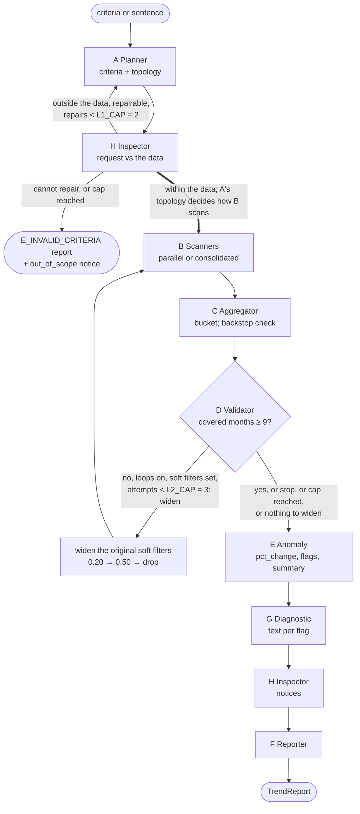

# Report draft, part 1: the system

*Draft (T61). The sources for every statement are named inline.*

## 1. System

plotline answers a question about Chennai house prices with a 12-month trend. The input is either structured `Criteria` (localities, `window_end`, BHK, price band, sqft range, sale condition) or one English sentence. The output is a `TrendReport` with one record per (month, region): `ALL` plus each selected locality. Each record holds `listing_count`, `n_in_bucket`, the median price, the median price per sqft and the month-on-month change. The report also carries anomaly flags, a first-3 vs last-3 month summary, a `coverage_score`, `notices` (plain sentences telling the user how the question was answered: a repair, a widening, a locality with no sales, a request outside the data), the full execution `trace` and `metadata` (`GLOBAL_CONTRACT.md` §6).

Eight agents, run by the orchestrator (`src/plotline/orchestrator.py`; roles from `GLOBAL_CONTRACT.md` §7.1):

| Agent | Kind | Job | Uses the model |
|---|---|---|---|
| A Query Planner (`agents/planner.py`, `nl_rules.py`) | decision-maker | Sentence or criteria → valid `Criteria`; picks the scanner topology; repairs bad criteria (L1) | AI mode only: sentence → `Criteria` |
| H Inspector (`agents/inspector.py`; added in contract 1.2.0) | worker | Before every scan, checks the request against what the data holds and sends repairable problems to A (L1); at the end, writes the `notices` | No |
| B Scanners (`agents/scanner.py`) | worker | Return the matching rows; one scanner per locality (parallel) or one for all (consolidated) | No |
| C Result Aggregator (`agents/aggregator.py`) | worker | Builds the dense grid of buckets, counts and medians; keeps the criteria check as a backstop | No |
| D Coverage Validator (`agents/validator.py`) | decision-maker | Counts the covered months; decides `widen` or `stop` (L2) | `widen` / `stop` only; the rule is `widen` when the model is off |
| E Anomaly Detector (`agents/anomaly.py`) | worker | `pct_change`, `price_jump` / `count_drop` flags, summary | No |
| G Diagnostic (`agents/diagnostic.py`) | text writer | A plain-language reason for each flag | Yes (a template when the model is off) |
| F Reporter (`agents/reporter.py`) | worker | Assembles the `TrendReport` | No |

The model never produces a number (decision D11). It turns a sentence into criteria, chooses between two actions and writes text. Every figure in a report is computed by code, and a separate test oracle (`tests/mt/oracle.py`) recomputes the figures without importing application logic.

The model inside the application is Gemma 4 E4B-it (Q4_K_M GGUF), served locally by `llama serve`. Thinking is on for the Planner and off for the Validator and Diagnostic (contract 1.1.2). Live answers are written to a replay cache keyed by the prompt, the model tag and the thinking setting, so that runs can be reproduced without a GPU (`contracts/LLM.md`). Mode B was recorded on a hosted model instead (`nvidia/nemotron-3-super-120b-a12b:free` on OpenRouter, `docs/diagnosis/MR9.md`); every result names the model it came from.

## 2. Data source

| Item | Value (source: `contracts/Data.md` §1, §3) |
|---|---|
| Dataset | Kaggle "Chennai Housing Sales Price", `kaggle.com/datasets/kunwarakash/chennai-housing-sales-price` |
| Raw file | `data/raw/Chennai_Housing_Sale.csv`, committed unchanged, 7,109 rows, SHA-256 `f7ba74d1…6a64` |
| Coverage | 7 localities, sales from 2004-01 to 2015-02 |
| Snapshot | `data/chennai_snapshot.csv`, 7,108 rows, SHA-256 `18487b6f…6209` (`data/SNAPSHOT.sha256`) |
| Licence | Open Database Contents License (DbCL) v1.0, <https://opendatacommons.org/licenses/dbcl/1-0/>, as stated on the Kaggle page |

The snapshot is produced once by `scripts/freeze_snapshot.py` with five logged cleaning rules:
* R1: 38 locality spellings fixed;
* R2: 15 sale-condition spellings fixed;
* R3: the one row with no bedroom count dropped (decision D8);
* R4: dates parsed to ISO;
* R5: seven columns kept, sorted by `listing_id`.

The application and the tests read only the snapshot, and every run checks its hash (`E_SNAPSHOT_HASH` on a mismatch). The application never deduplicates rows (D3): one row is one sale.

## 3. Control-flow graph

From `GLOBAL_CONTRACT.md` §7.3. L3 (Anomaly → Scanners) is out of scope and not drawn.



* **L1 (H → A), feedback loop.** (C → A until contract 1.2.0; C keeps the same check as a backstop.) All repairable issues found in one pass count as one repair: `band_inverted` → swap; `locality_unknown` → the closest canonical name; `window_out_of_range` → clamp; `bhk_out_of_range` → drop the bad value. Each repair is told to the user as a `repaired` notice. Why H was added: `docs/design_changes.md` C23. The cap is `L1_CAP = 2` (`src/plotline/contract.py:58`).
* **L2 (D → B), conditional retry.** It fires when fewer than `COVERAGE_MIN_MONTHS = 9` of the 12 `ALL` months have `n_in_bucket ≥ MIN_BUCKET_N = 5`. It widens only the soft filters (D7), always starting from the **original** values, by the steps `L2_WIDEN = (0.20, 0.50, "drop")`. The cap is `L2_CAP = 3` (`src/plotline/contract.py:53-60`). With the model on, D may choose `stop`.
* **Dependency (A ⇒ B).** The topology changes how the scanners work, not the numbers (invariant I-TOPO).
* `RunOptions.loops_enabled = false` turns both loops off. This test hook is used in the diagnosis.

## 4. UI

A web front end (built with Lovable against `examples/example_response.json`) calls the FastAPI app in `src/plotline/api.py`: `GET /api/health`, `GET /api/meta` and `POST /api/run`. All rounding happens in the UI; the application never rounds (`GLOBAL_CONTRACT.md` §6.3).

## 5. Trace excerpt

A real run: Anna Nagar, the 12 months to 2014-06, price band ₹12.40M–18.30M, `LLM_MODE=off`. This is the source run of MR10 base 321, from `results/diagnosis/MR10_base321_trace.txt` (`python -m tests.mt.diagnose --mr MR10 --base-id 321`).

```
[ 0] planner    decision     topology=consolidated (1 localities < 3)
[ 1] scanner    step         scan: 1 scanner(s), consolidated: 44 rows
[ 2] aggregator step         24 buckets (12 months x 2 regions), 44 rows in the window
[ 3] validator  loop     L2  L2 fired: coverage 4/12 below 9/12; widen soft ranges by 20%; attempt 1 of 3
[ 4] scanner    step         scan: 1 scanner(s), consolidated: 61 rows
[ 5] aggregator step         24 buckets (12 months x 2 regions), 61 rows in the window
[ 6] validator  loop     L2  L2 fired: coverage 8/12 below 9/12; widen soft ranges by 50%; attempt 2 of 3
[ 7] scanner    step         scan: 1 scanner(s), consolidated: 73 rows
[ 8] aggregator step         24 buckets (12 months x 2 regions), 73 rows in the window
[ 9] validator  decision     coverage 9/12 meets 9/12
[10] anomaly    step         3 flag(s); summary over 73 rows
```

* Event 0 is the A ⇒ B dependency: one locality, so one consolidated scanner.
* Events 3 and 6 are L2 firings (`kind = loop`). Each widens the **original** band, first by 20 % and then by 50 %, so the rows grow 44 → 61 → 73 and the covered months 4 → 8 → 9. The final `effective_criteria.price_band` is [9451885, 21249345] (₹9.45M–21.25M), and `loop_counters.L2_attempts = 2`.
* Event 9: D finds coverage met and stops the loop. The pipeline continues to E.
